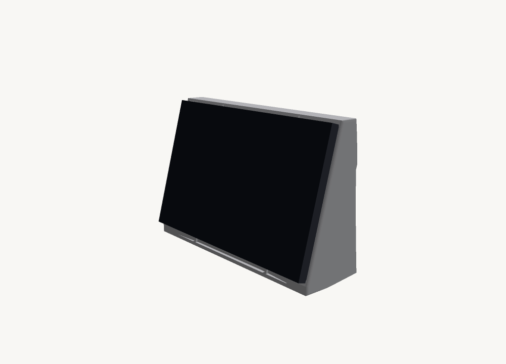
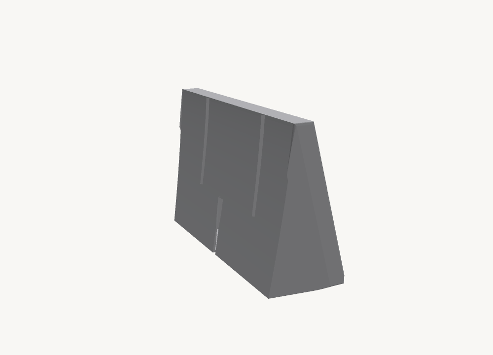
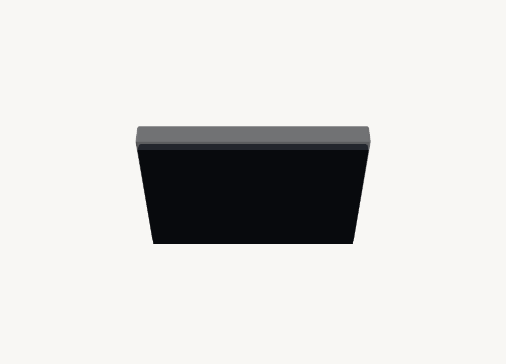
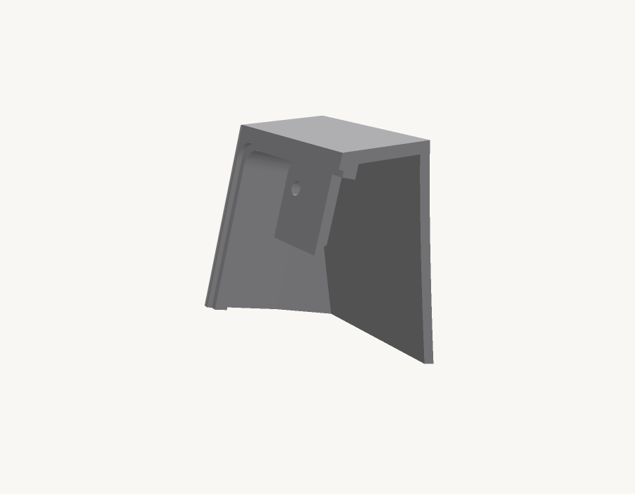

# Bench dock — Waveshare 10.1" DSI touch panel

A one-piece printed dock that holds a **10.1-DSI-TOUCH-A (WS-30052)** panel at a
15° lean with a Raspberry Pi sealed inside it. Built to run a Home Assistant
dashboard on a kitchen bench.

```
246 × 158 × 78 mm     249 cm³, ~308 g     watertight, 7,426 tri
```



The glass drops into a 1.1 mm recess from the front and finishes flush. The
chassis passes through a flange-sized opening behind it and screws to four
tabs. The back is closed — no window, no visible fasteners — and the flanks
draw in 10 mm a side starting at the screen edge, so the front reads thinner
than the body is.

| | |
|---|---|
|  |  |
| Closed back — the cable slot is the only opening | Flanks drawing in from the screen edge |

## Print it

| | |
|---|---|
| Orientation | base down, **no supports** |
| Bed needed | 246 × 78 mm whole, 123 × 78 mm split |
| Layer height | 0.24 mm |
| Walls | 6 at 0.4 mm |
| Material | PLA or PETG |
| Filament | ~308 g whole, ~152 g per half |

```
rev-m-coupon.stl      11 g   one corner — PRINT THIS FIRST
rev-m-dock.stl       308 g   one piece
rev-m-dock-half.stl  152 g   print two and glue; the panel braces the seam
```



**Print the coupon first.** It is the top-right corner of the real model —
same recess, same opening edge, same tab and hole — for 12 g and half an hour
instead of 308 g and most of a day. Check three things in order: does the panel
corner seat into the recess and finish flush, does the flange pass the opening
without forcing, does an M2.5 screw line up with the tab hole.

```
openscad -o dock-whole.stl dock.scad      # whole
openscad -D split=true  -o half.stl dock.scad
openscad -D coupon=true -o coupon.stl dock.scad
python3 verify_dock.py dock-whole.stl     # see below — this is not optional
```

## The panel, measured

Waveshare publish none of this. It came out of their STEP model, cross-checked
against the drawing's side-view callouts.

| layer | thickness | outline |
|---|---|---|
| glass | 1.10 mm | 239.00 × 147.00 — outermost **and** largest |
| sub-bezel | 1.70 mm | 229.07 × 143.00 |
| flange | 3.40 mm | 230.70 × 145.10 — widest thing behind the glass |
| metal back | 4.30 mm | 223.10 × 137.99 |
| **total** | **10.80 mm** | glass front to chassis rear |

Three things that are easy to get wrong:

- **A stepped pocket is impossible.** The sub-bezel behind the glass is
  *narrower* (143.00) than the flange behind **it** (145.10), so the flange
  could never clear an intermediate step. The opening is flange-sized through
  the full wall thickness.
- **The flange is not centred on the glass** — it sits 2.78 mm off along the
  long axis, and the four mounting holes carry the same offset. Centring the
  opening leaves a 1.97 mm bezel on one edge and 7.53 mm on the other.
- **The thread is M2.5, not M3.** The drawing calls out 8-M2.5 and the tapped
  holes measure Ø2.04. An M3 screw will not enter one.

## Power

The panel takes 5 V and ground **from the Pi's GPIO header**, on every Pi —
15-pin and 22-pin alike. It wants **≥ 0.8 A at 5 V** or, in Waveshare's words,
*"it will cause the startup failure or display abnormality"*. That is ~4 W
through the Pi's own rail on top of the Pi, so use the official supply. A weak
charger presents as a dead display rather than a power fault.

## The Pi is sealed inside

It bolts to the **panel's** back on the 58 × 49 pattern, not to the dock, and
the whole assembly drops in from the front. Clearance behind the panel is
25.2 mm at the Pi's top edge against a 22.4 mm stack (5 standoff + 1.4 board +
~16 USB-A), and 36.4 mm at the board centre.

The cost of a closed back is heat. Four slots in the base are the only airflow
and there is no high outlet, so they ventilate by leakage rather than
convection. **If it throttles, put a heatsink on the Pi** — there is 14 mm
spare over the SoC — rather than cutting holes in the back.

## Checking is not optional

`check.py` proves the mesh is watertight and manifold. That is necessary and
nowhere near sufficient, and this project has the scars:

- A cut silently stopped cutting when an edit deleted two variables and
  OpenSCAD substituted `undef`. The mesh stayed watertight, stayed manifold,
  kept the right bounding box. **Volume going *up* after adding two cuts was
  the only tell.**
- Tapering the finished shell sliced the side walls off and left the cavity
  open along both flanks. Still watertight — an open-sided shell is still a
  closed surface.

So `verify_dock.py` fires rays through everything that is supposed to be a hole
and measures what it finds: the Pi clearance, the recess against the rounded
flank, that the flank is a wall and not an opening, the base vents, the cable
slot. It reads its parameters out of `dock.scad` rather than hardcoding them,
because hardcoding rotted the first time a dimension moved and it then blamed
the model.

`overhang.py` measures real overhang angles off the mesh rather than asserting
them. Current model: **3.65 % of surface area past 45°, all of it internal** —
the cavity ceiling and the slot roofs. Nothing external overhangs, so no
supports.

## Files

```
dock.scad                    parametric source — the one to edit
verify_dock.py               proves the cuts actually cut
check.py                     manifold / volume / bbox
overhang.py                  overhang angles for the base-down print
dockrender.py                pure-Python renderer, no dependencies
panel-ws23450-measured.md    a DIFFERENT panel — read its banner
superseded/                  the earlier two-feet design
```

> `panel-ws23450-measured.md` documents the **(C)** panel, not the (A) this is
> built for. Kept as a worked example of measuring a panel from its STEP. The
> two genuinely disagree — (C) needs a stepped pocket and (A) forbids one.

Panel geometry owes a lot to [kaushik1A1A1A's CadQuery enclosure][ref] for the
same display, including the mounting-hole coordinates and the tolerances, which
are theirs and are backed by printed hardware.

[ref]: https://github.com/kaushik1A1A1A/3D-printed-Enclosure-case-for-Waveshare-10.1-DSI-TOUCH-A
