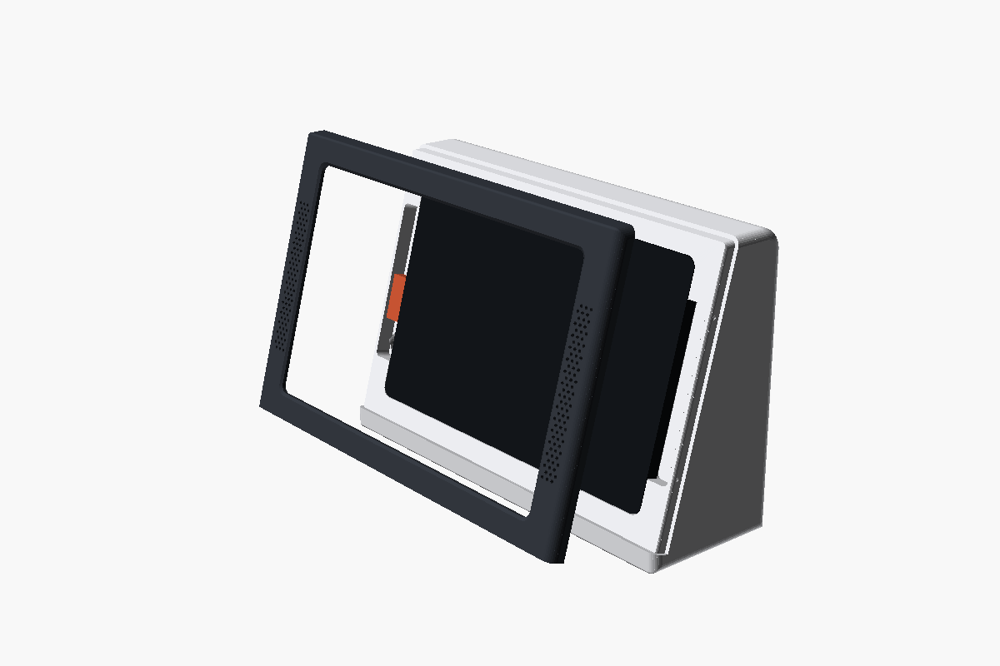

# tab-panel: Echo Show-style enclosure (experimental)

**This is the `echo-style` branch.** It's an experiment, kept apart in case it doesn't work out.
The main branch has the tapered slide-in dock for the same tablet.

An enclosure for an **ALLDOCUBE iPlay 80 mini Turbo (8.8")** running a Home Assistant dashboard,
styled after the [Amazon Echo Show Enclosure](https://www.printables.com/model/1769972-amazon-echo-show-enclosure)
on Printables. It's a soft-cornered block with a separate bezel. Drop the tablet in, press the
bezel on, and the bezel holds the tablet. Print the bezel in a second colour.





## How it differs from the main dock

| | main: slide-in dock | this branch: enclosure |
|---|---|---|
| Shape | tapered back, 17° lean | block, flat top, vertical back, 15° lean |
| Holding the tablet | gravity in a pocket | a bezel that laps the glass by 1.5 mm |
| Taking it out | slide, then press to tip | pop the bezel off |
| Power | Adafruit 5521 magnetic adapter | any sideways right-angle USB-C cable |
| Speakers | slots in the flanks | Echo-style grilles in the bezel |
| Parts | one | body, bezel, four feet |

The bezel means the tablet doesn't come out casually. That suits a dashboard that lives in the
enclosure. It doesn't suit a tablet you pick up every day.

## The tablet

ALLDOCUBE's figures: 208.2 × 129.2 × 6.95 mm, 295 g. Held landscape **with the USB-C on the
left**. The power and volume keys are on a long edge near the camera end, so port-left puts
them on top. Port-right would stand the tablet on its power key. The speakers are on the two
short edges. The camera is a Pixel-style bar at the right end of the back.

## How it works

- **Body.** A hollow block with 2.4 mm walls and a solid front wall behind the pocket. Its
  flank edges are rounded at 5 mm and its top-back edge at 12 mm. The 12 mm band under the
  bezel is the plinth.
- **Pocket.** 0.4 mm clear of the tablet all round. The glass sits level with a tenon round the
  face. The tablet's back floats 0.15 mm off a 12 mm rim, and inside the rim the floor is 1 mm
  deeper.
- **Camera recess and rib.** As on main: the camera bar takes out the right rim, so it gets a
  5.2 mm recess, and an 8 mm rib inboard of it carries that end.
- **Bezel.** A 3 mm plate with a skirt down the sides and over the top, 2 mm thick and 6 mm
  deep. It slides onto the tenon along the face normal with 0.15 mm clearance, and its bottom
  edge sits on the plinth. **Two 0.3 mm bumps on each side skirt** snap into dimples in the
  tenon. The opening laps the glass by 1.5 mm, with a 1 mm chamfer at the front.
- **Speaker chambers.** Beside each short edge is a 13 mm chamber, open to the tablet's edge.
  The bezel covers it with a hex grille of 1.8 mm holes.
- **Power.** A **sideways ("left/right") right-angle USB-C** plug goes in the tablet's port
  before the tablet goes in. Its head sits in the left chamber. The cable runs down the
  chamber into a 14 mm duct, through the body, and out low on the back. Thread the cable's
  far plug in from the chamber end first. A USB-A plug needs `duct_d = 17`.
- **Feet.** Four 20 mm recesses in the base take TPU discs (`echo-foot.stl`, print four), or
  stick-on feet. Each stands 0.6 mm proud.

## Printing

| File | What | Orientation |
|---|---|---|
| `echo-body.stl` | the body, 245 × 80 × 161 mm, about 700 g of PLA by volume | base down |
| `echo-bezel.stl` | the bezel, 245 × 156 × 9 mm, about 50 g | face down |
| `echo-foot.stl` | one foot, TPU | flat, print four |
| `echo-coupon.stl` | the port end of the body's face and the bezel's matching end. **Print this first** | as laid out |

No supports. `printcheck.py` puts the worst reach over air at
9.9 mm for the body and 0.6 mm for the bezel, against a 15 mm limit.

### Print the coupon first

It's the left 50 mm of the face: tenon, chamber, a pocket corner, and the bezel's end with its
two bumps. Check that:

1. **the bezel snaps on and stays on.** If it won't go on, lower `bump_h`. If it falls off,
   raise it, or tighten `fit`;
2. the right-angle plug, in the tablet, drops into the chamber with its cable;
3. the tablet's corner fits the pocket's corner, and the bezel lap clears the screen.

### Check against the real tablet

As on main, these come from photos, not the tablet:

- **the camera bar**: about 118 × 29 mm, 7.6 mm from the end, lens rings about 4.5 mm proud;
- **corner radius ≥ 6 mm**;
- **the speakers** within 20–110 mm along each short edge;
- **the port** centred on its edge (`port_y = 0`);
- **the keys** on top with the port on the left.

Measure your right-angle plug too. The defaults (`pl_*`) are a generic one: 26 mm along the
edge, 11 mm off it, 6.5 mm thick.

## Rebuilding

```
openscad -D 'part="body"'   -o echo-body.stl   enclosure.scad
openscad -D 'part="bezel"'  -o echo-bezel.stl  enclosure.scad
openscad -D 'part="foot"'   -o echo-foot.stl   enclosure.scad
openscad -D 'part="coupon"' -o echo-coupon.stl enclosure.scad
python3 check.py echo-*.stl         # manifold, volume, bbox
python3 printcheck.py echo-*.stl    # reach over air, layer by layer
openscad -D 'part="fit"'     -o fit.stl  enclosure.scad   # each of these three must say
openscad -D 'part="plugfit"' -o plug.stl enclosure.scad   # "top level object is empty"
openscad -D 'part="mate"'    -o mate.stl enclosure.scad
```

`fit` intersects body and bezel with the tablet, camera bar included. `plugfit` does the same
with the plug, and `mate` checks the body against the bezel, bumps included. `part="show"`
and `part="open"` are for renders.

OpenSCAD 2021.01. A full render takes about three minutes. `printcheck.py` needs numpy.
