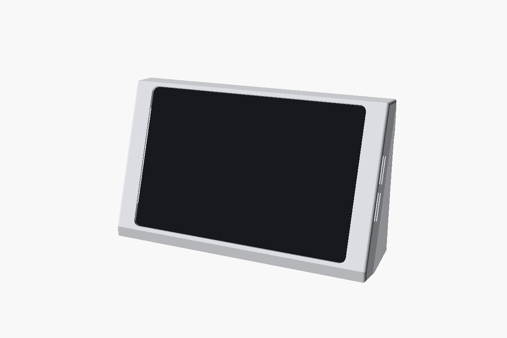
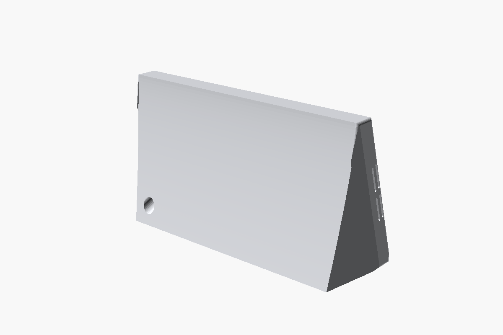
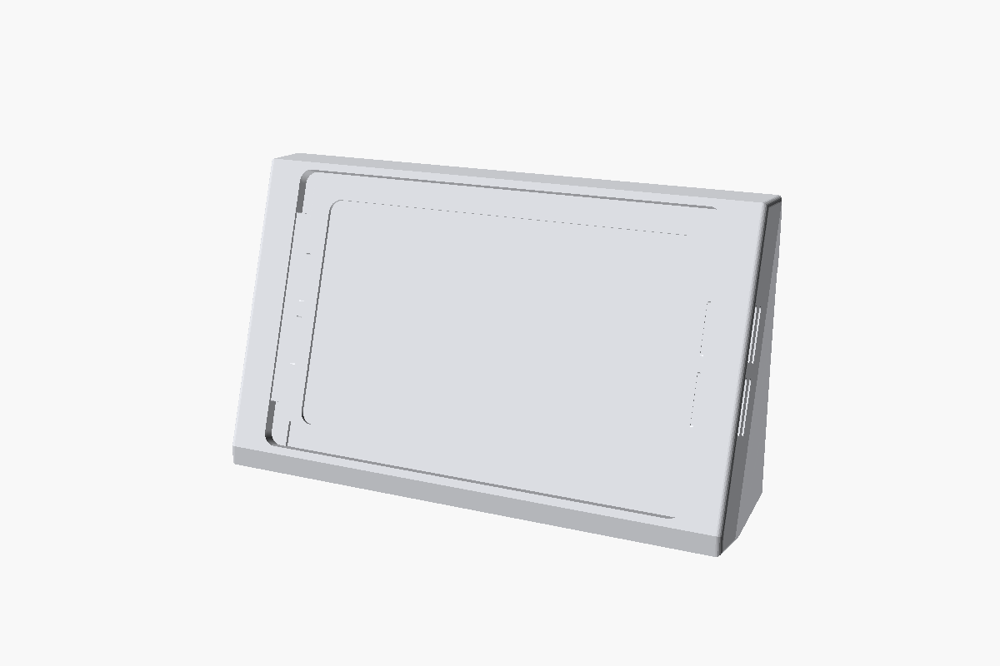
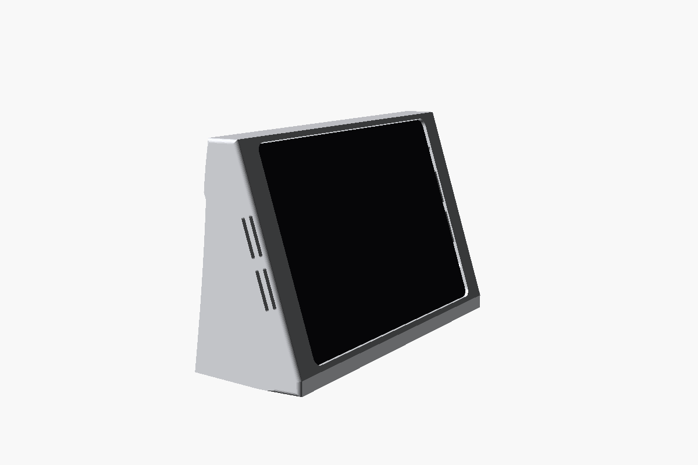

# tab-panel

A 3D-printed bench dock for a **Lenovo Legion Tab (8.8", Gen 3)** running a Home Assistant
dashboard. Slide the tablet in and it charges. From the front there's no cable, no plug
and no gap: just the tablet in an even bezel. It prints **in one piece**.

It's forked from [pi-panel](https://github.com/Boldestfutura/pi-panel), the dock for a
Waveshare 10.1" panel and a Raspberry Pi 4B, and keeps that body: soft flanks, a tapered
back and recessed feet, at a 17° lean. (It was drawn for an 11" Tab P11 first. Beside a 7"
Nest Hub that was far too big; it's in the git history.)






## The tablet

From Lenovo's [PSREF](https://psref.lenovo.com/Product/Lenovo_Tablets/Legion_Tab_8_8_3):
208.54 × 129.46 × 7.79 mm, about 350 g. Held landscape with the buttons on top:

- the **charging USB-C (Hi-Speed)** is in the middle of the **right-hand short edge**. That's
  the one the magnetic nub goes in;
- the second USB-C (10 Gbps, DP out) is in the middle of the bottom edge. The pocket
  covers it and it isn't used. Lenovo says the two can't charge at once anyway;
- the power and volume buttons are on the top edge, under the top bezel. Wake the
  screen by touch or from Home Assistant.

## How it works

- **Pocket and bezel.** The pocket is 0.4 mm clear of the tablet all round, and 2 mm
  deep past the glass, so the dock's face stands just proud of the screen as a bezel. The
  17° lean and the pocket walls hold the tablet, with nothing to clip.
- **Rim and relief.** The tablet's back rests on a 12 mm rim. Inside the rim the floor is
  1.5 mm deeper. The camera bump's size and position aren't published, so this lets it
  sit anywhere.
- **Hidden chambers.** Beside each short edge, behind a 1.2 mm skin of bezel, is a
  15 mm chamber that opens onto the tablet's edge below the glass. The speakers fire into
  it and out through **slots in each flank**, running up the face. The corners stay
  solid, so the tablet is still located.
- **Push to release.** The bottom rim is cut away, leaving a 1.5 mm well behind the
  tablet's bottom 12 mm. Press the tablet's bottom edge and it pivots on the lower ends of
  the side rims, and the top tips about 15 mm out of the pocket, ready to grab. Taps on the
  screen above the pivot just press it onto the rims.

### Docking: slide it on

The bezel is unbroken all round, so the magnetic nub, which stands 2 mm off the tablet's
edge, can't drop through it. The tablet slides instead:

- **In:** tuck the left end about 3 mm under the left bezel, lower the right end into
  the pocket, then slide it right. The magnet snaps on.
- **Out:** slide it left about 3 mm, which parts the magnet, then press the bottom edge to
  tip it out.

There is a 3 mm recess under the left bezel, the full height of the pocket, for the
tucked end. It's hidden once the tablet is home.

### Power: magnetic, hidden

Power goes through an **[Adafruit 5521](https://www.adafruit.com/product/5521) magnetic
right-angle USB-C adapter** (120 W, data as well; Core Electronics stocks it as ADA5521).

- A small nub lives in the tablet's USB-C port. The adapter sits in the right-hand
  chamber, its magnetic face against the tablet's edge, hidden behind the bezel. Slide the
  tablet home and the nub snaps onto it.
- Any **straight USB-C cable** plugs into the adapter's other end. It runs down the
  chamber, out of sight, and into a 14 mm duct through the body to an exit low on the
  back.
- **Fitting it:** before the adapter goes in, feed the cable's far plug in at the bottom of
  the chamber and out of the back. Then plug the adapter on and sit it in the chamber.
- The duct takes a USB-C plug. A USB-A plug needs `duct_d = 17`.
- Lenovo wants a USB-PD charger of at least 15 W; 45 W or more charges it at full speed.

The adapter's size isn't published. `ad_l`, `ad_w`, `ad_t`, `nub_proud` and `nub_l` are
estimates. **Measure the real adapter and set them before printing the dock.** The model
checks the adapter clears the bezel (`part="adapter"` must come out empty), and rejects one
too thick to fit.

## Printing

It's 246 × 80 × 140 mm, which fits the P2S's 256 mm bed, so it **prints in one piece**,
base down, without supports. The worst reach over air is 10.8 mm, measured by
`printcheck.py`, against a 15 mm limit. A solid web runs from the cable duct down to the
floor, so the duct has something under it. About 410 g of PLA by volume; the slicer's
infill brings that down.

| File | What |
|---|---|
| `tab-dock.stl` | the dock, print orientation |
| `tab-dock-coupon.stl` | the right-hand chamber and bezel, ~13 g, prints flat, no slots. **Print this first** |

### Print the coupon first

No dimension here has been checked against a real tablet or adapter. The coupon is the
right-hand side of the face, from the bottom of the chamber to past the port. Check that:

1. the adapter fits the chamber and the bezel hides it,
2. with a cable plugged into the adapter, the plug and cable fit down the chamber,
3. the tablet slides across with the nub under the bezel and finds the adapter,
4. the glass sits just below the bezel.

### Check against the real tablet

These aren't published, and the design assumes them:

- **Corner radius ≥ 6 mm.** The pocket's corner is 6 mm. A tighter tablet corner would
  hit it.
- **Speakers on the short edges.** Lenovo lists two, not where. If they're on the long
  edges, the frame muffles them.
- **The port is centred** on its edge (`port_y = 0`), as Lenovo's drawing shows. If not,
  set `port_y`.

## Rebuilding

```
openscad -D 'part="print"'  -o tab-dock.stl        dock.scad
openscad -D 'part="coupon"' -o tab-dock-coupon.stl dock.scad
python3 check.py tab-dock*.stl          # manifold, volume, bbox
python3 printcheck.py tab-dock*.stl     # reach over air, layer by layer
openscad -D 'part="fit"'     -o fit.stl dock.scad   # each of these four must say
openscad -D 'part="adapter"' -o ad.stl  dock.scad   # "top level object is empty"
openscad -D 'part="slide"'   -o sl.stl  dock.scad
openscad -D 'part="nubfit"'  -o nf.stl  dock.scad
```

`part="fit"` intersects the dock with a tablet-sized block in the pocket, and
`part="adapter"` with the adapter in its chamber. `part="slide"` puts the tablet slid
3 mm away from the port, with the nub's path straight down from in front: that's docking.
`part="nubfit"` checks the nub's spot with the tablet home. If anything comes out, plastic
is in the way. `part="bare"` and `part="tablet"` are for renders.

OpenSCAD 2021.01. `printcheck.py` needs numpy.
