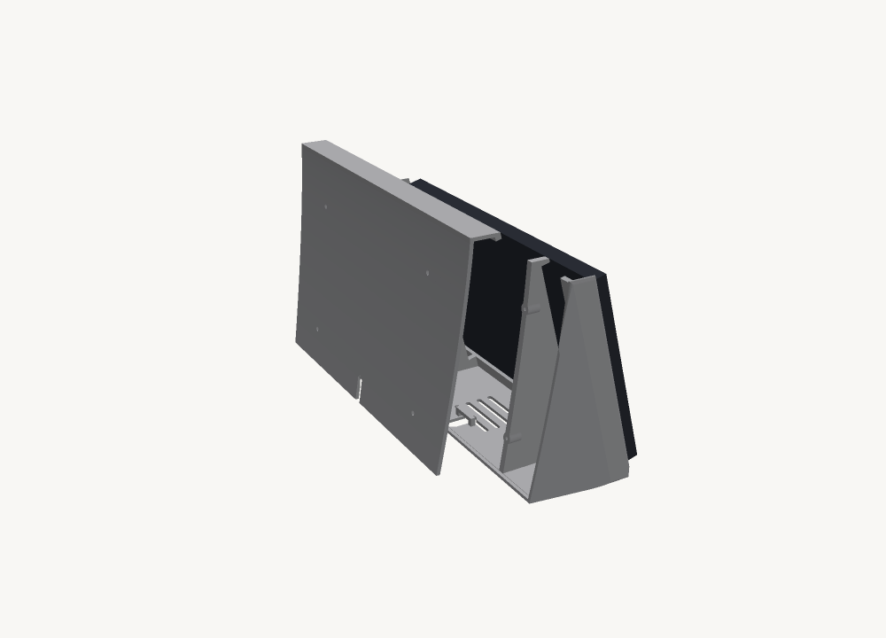

# Bench dock — Waveshare 10.1" DSI touch panel

A printed dock that holds a **10.1-DSI-TOUCH-A (WS-30052)** panel at a 15°
lean with a Raspberry Pi 4B inside it. Built to run a Home Assistant dashboard
on a kitchen bench. Rev N: two parts, a body and a cover.

```
246 × 158 × 78 mm     body ~190 g + cover ~123 g     no supports
```


The glass drops into a 1.1 mm recess from the front and finishes flush. The
chassis passes through a flange-sized opening behind it and screws to four
tabs. The back, the top and the strip above the screen are one removable
cover, held by four M3 screws, and the flanks draw in 10 mm a side starting at
the screen edge, so the front reads thinner than the body is.

| | |
|---|---|
|  |  |
| Cover on — four screws and the cable slot | Cover off — every screw and the Pi in reach |

## Why two parts

Rev M was one closed piece. It passed every check it had and could not have
been built:

- **The panel could not be screwed in.** The tabs take screws from behind and
  the back was sealed; the top two had 7 mm of air behind them.
- **The Pi did not fit.** The right bulkhead sat 1.2 mm behind the panel,
  straight through the board. The clearance check sampled three columns and the
  bulkhead was between two of them.
- **The edge above the screen could not print.** Base-down it was a ceiling
  230 mm wide over the opening, held only at its ends. Orca called it a
  floating cantilever.

The cover fixes the first and third at once: the strip above the screen is
part of it, so the body's front is a U with nothing to bridge, and taking it
off opens the whole back. The bulkheads moved out to ±75 mm, and the top tabs
gained a 45° web to the side wall so they grow from something.

## Print it

| | body | cover |
|---|---|---|
| Orientation | base down | top down |
| Supports | none | none |
| Footprint | 246 × 78 mm, 158 tall | 241 × 39 mm, 155 tall |
| Filament | ~190 g | ~123 g |

Both STLs load in print orientation — drop them on the plate as they are.
Layer height 0.24 mm, 6 walls at 0.4 mm, PLA or PETG. The cover stands on its
narrow top face, so give it a brim.

```
rev-n-coupon.stl    13 g   bottom-right corner — PRINT THIS FIRST
rev-n-body.stl     190 g
rev-n-cover.stl    123 g
```

**Print the coupon first.** It is the bottom-right corner of the real body —
same recess, same opening edge, same tab and hole — for 13 g and half an hour.
Check three things in order: does the panel corner seat into the recess and
finish flush, does the flange pass the opening without forcing, does an M2.5
screw line up with the tab hole.

```
openscad -D 'part="assembled"' -o dock-assembled.stl dock.scad
openscad -D 'part="body"'      -o rev-n-body.stl     dock.scad
openscad -D 'part="cover"'     -o rev-n-cover.stl    dock.scad
openscad -D 'part="coupon"'    -o rev-n-coupon.stl   dock.scad
python3 verify_dock.py dock-assembled.stl rev-n-body.stl
python3 printcheck.py rev-n-body.stl rev-n-cover.stl rev-n-coupon.stl
```

## Assemble it

You need four M2.5 × 6 screws for the panel, four M3 × 10 pan-head screws for
the cover, a zip tie up to 4.8 mm wide, and a stubby screwdriver — the bottom
two panel screws have 45 mm of room behind them.

1. Bolt the Pi to the panel's back and connect the DSI ribbon and the GPIO
   power leads.
2. With the cover off, pass the panel and Pi in through the front until the
   glass sits in its recess.
3. From behind, screw the panel to the four tabs.
4. Plug the USB-C lead into the Pi, lay it across the bar over the slot in the
   base, zip-tie it there, and let it out through the slot at the back.
5. Fit the cover between the side walls and drive the four M3 screws. They cut
   their own thread in the 2.5 mm pilots; don't overtighten into PLA.

## The panel, measured

Waveshare publish none of this. It came out of their STEP model, cross-checked
against the drawing's side-view callouts.

| layer | thickness | outline |
|---|---|---|
| glass | 1.10 mm | 239.00 × 147.00 — outermost **and** largest |
| sub-bezel | 1.70 mm | 229.07 × 143.00 |
| flange | 3.40 mm | 230.70 × 145.10 — widest thing behind the glass |
| metal back | 4.30 mm | 223.10 × 137.99 |
| **total** | **10.80 mm** | glass front to chassis rear |

Three things that are easy to get wrong:

- **A stepped pocket is impossible.** The sub-bezel behind the glass is
  *narrower* (143.00) than the flange behind **it** (145.10), so the flange
  could never clear an intermediate step. The opening is flange-sized through
  the full wall thickness.
- **The flange is not centred on the glass** — it sits 2.78 mm off along the
  long axis, and the four mounting holes carry the same offset. Centring the
  opening leaves a 1.97 mm bezel on one edge and 7.53 mm on the other.
- **The thread is M2.5, not M3.** The drawing calls out 8-M2.5 and the tapped
  holes measure Ø2.04. An M3 screw will not enter one.

## Power

The panel takes 5 V and ground **from the Pi's GPIO header**, on every Pi —
15-pin and 22-pin alike. It wants **≥ 0.8 A at 5 V** or, in Waveshare's words,
*"it will cause the startup failure or display abnormality"*. That is ~4 W
through the Pi's own rail on top of the Pi, so use the official supply. A weak
charger presents as a dead display rather than a power fault.

The USB-C lead leaves through a slot in the base at the back. Zip-tie it to
the bar arched over that slot, so a tug on the cable stops at the dock instead
of the Pi's socket. The slot is open underneath, so the tie can be redone from
below without taking the cover off.

## The Pi is inside

It bolts to the **panel's** back on the 58 × 49 pattern, not to the dock, and
the whole assembly goes in from the front. Clearance behind the panel is
25.2 mm at the Pi's top edge against a 22.4 mm stack (5 standoff + 1.4 board +
~16 USB-A), and 36.4 mm at the board centre, all the way across the board.

The cost of a closed cover is heat. Four slots in the base are the only airflow
and there is no high outlet, so they ventilate by leakage rather than
convection. **If it throttles, put a heatsink on the Pi** — there is 14 mm
spare over the SoC — rather than cutting holes in the back.

## Checking is not optional

`check.py` proves the mesh is watertight and manifold. That is necessary and
nowhere near sufficient, and this project has the scars:

- A cut silently stopped cutting when an edit deleted two variables and
  OpenSCAD substituted `undef`. The mesh stayed watertight, stayed manifold,
  kept the right bounding box. **Volume going *up* after adding two cuts was
  the only tell.**
- Tapering the finished shell sliced the side walls off and left the cavity
  open along both flanks. Still watertight — an open-sided shell is still a
  closed surface.
- Rev M passed all of it and could not be assembled or printed — see *Why two
  parts*.

So `verify_dock.py` fires rays through everything that is supposed to be a hole
and measures what it finds: the Pi clearance every 5 mm across the board, the
recess against the rounded flank, that the flank is a wall and not an opening,
the base vents, the cable slot, the zip-tie bar, the cover screws landing in
their bosses, and — given the body on its own — room for a driver behind every
tab. It reads its parameters out of `dock.scad` rather than hardcoding them,
because hardcoding rotted the first time a dimension moved and it then blamed
the model.

`printcheck.py` slices each part the way the printer will and measures how far
any layer reaches across air from something under it. The limit is 15 mm. Rev M
base-down fails it at 58 mm, at the edge above the screen; Rev N's worst is the
foot recesses at 11 mm. It replaced `overhang.py`, which measured face angles
and reported "nothing external overhangs" on that same model.

One thing no script here can check: the webs under the top tabs sit 0.2 mm
behind the panel's back edges, 17–28 mm in from each side wall. If the panel
has anything raised there, it will hit them.

## Files

```
dock.scad                    parametric source — the one to edit
verify_dock.py               proves the cuts cut and the parts fit
printcheck.py                proves each part prints without supports
check.py                     manifold / volume / bbox
dockrender.py                pure-Python renderer, no dependencies
panel-ws23450-measured.md    a DIFFERENT panel — read its banner
superseded/                  the earlier two-feet design
```

> `panel-ws23450-measured.md` documents the **(C)** panel, not the (A) this is
> built for. Kept as a worked example of measuring a panel from its STEP. The
> two genuinely disagree — (C) needs a stepped pocket and (A) forbids one.

Panel geometry owes a lot to [kaushik1A1A1A's CadQuery enclosure][ref] for the
same display, including the mounting-hole coordinates and the tolerances, which
are theirs and are backed by printed hardware.

[ref]: https://github.com/kaushik1A1A1A/3D-printed-Enclosure-case-for-Waveshare-10.1-DSI-TOUCH-A
